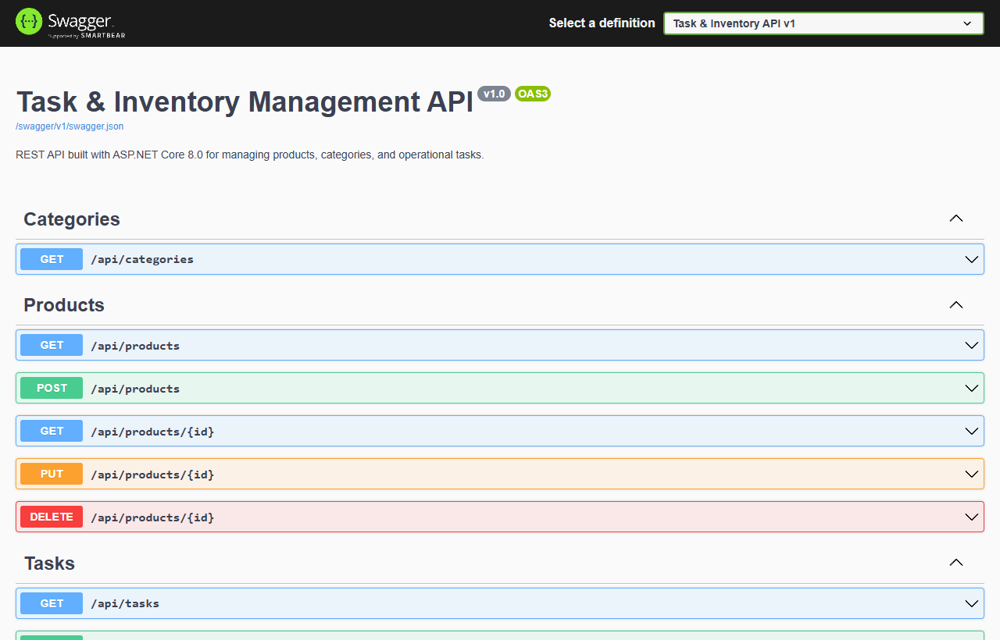

# Task & Inventory Management API

REST API built with C# and ASP.NET Core 8.0 for managing product inventory, categories, and operational tasks, documented with Swagger UI.



## Features

- CRUD endpoints for products (`/api/products`) with category filtering
- Task management endpoints (`/api/tasks`) with completion status updates
- Category summary endpoint (`/api/categories`)
- Interactive OpenAPI documentation via Swagger UI (`/swagger`)
- Automated unit tests using xUnit

## Tech Stack

- C# 12
- .NET 8 (ASP.NET Core Web API)
- Swashbuckle / Swagger UI (OpenAPI 3.0)
- xUnit

## Getting Started

1. Clone the repository:
```bash
git clone https://github.com/davyd9/task-inventory-api-dotnet.git
cd task-inventory-api-dotnet
```

2. Run the unit tests:
```bash
dotnet test
```

3. Start the API server:
```bash
dotnet run --project src/TaskInventory.Api
```

4. Open `http://localhost:5000/swagger` in your browser to test the endpoints.
